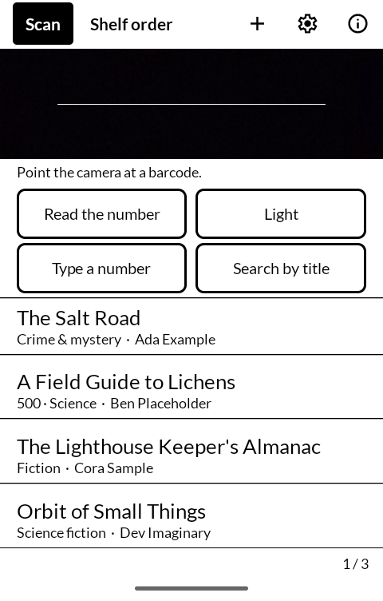
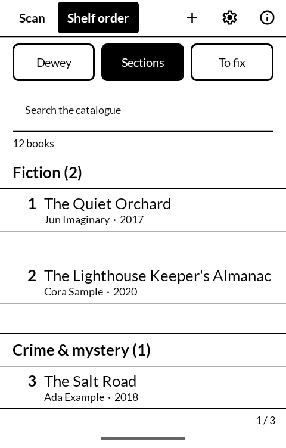
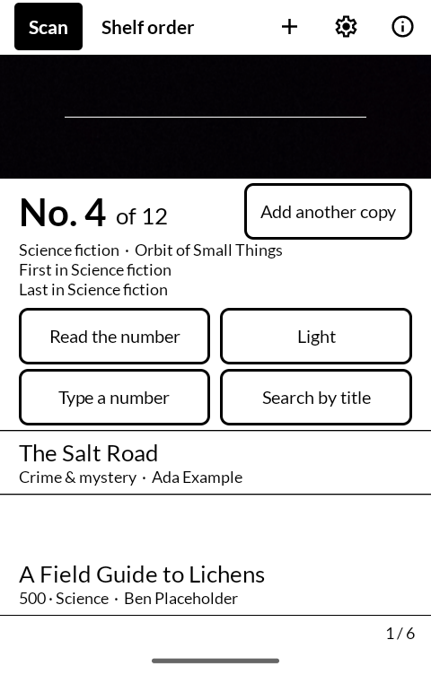
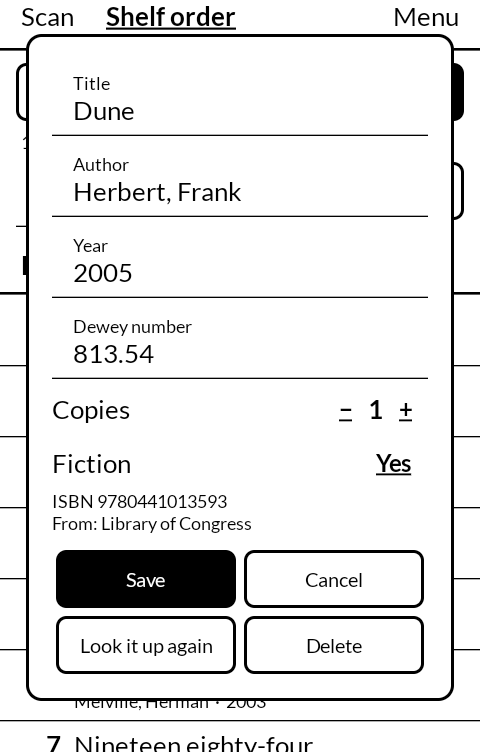

# Shelf

A book catalogue for the [Mudita Kompakt](https://mudita.com/products/kompakt/), made for
taking a whole house of books off the shelves and putting them back in order. Scan the
barcode on each book. Shelf finds the book's Library of Congress or Dewey call number and
lists the whole collection in the order it goes back on the shelf. It will install on any
Android 12 device with a camera.

| | |
|---|---|
|  |  |
|  |  |

## Cataloguing

- **Add books.** Point the camera at the barcode on the back cover. Each book goes into
  the catalogue the moment it is read, and is looked up in the background, so you can
  keep scanning without waiting. One beep for a new book; two for one already
  catalogued, which offers **Add another copy**.
- **Find its place.** Scan a book to see where it goes: its number in shelf order, and
  the books that stand either side of it.
- **Type a number** takes an ISBN, or an LCCN from the copyright page of a book printed
  before ISBNs.
- **No ISBN** searches the Library of Congress by title and author, or adds the book by
  hand.
- A barcode that isn't an ISBN (often a price code on a paperback) is turned away with a
  low tone.

Without a connection, books are still scanned and kept. They are looked up when the
connection comes back.

## Shelf order

**Library of Congress** or **Dewey**, switched at the top of the list. LC numbers sort
the way a library shelves them: class letters, then the class number, then each Cutter
read as a decimal. Books with no number for the chosen system come after the numbered
ones, by author and then by title.

**To fix** narrows the list to the books still to be looked up or that no catalogue knew,
and the books with no call number. Tap any book to correct it, change the number of copies,
look it up again, or delete it.

## Where the details come from

The [Library of Congress catalogue](https://www.loc.gov/) first, then
[Open Library](https://openlibrary.org/) for anything it lacks. Neither needs an account.

## Keeping the list

The catalogue lives on the phone. **Menu → Save as a spreadsheet** writes it out in
shelf order as a CSV, and **Add from a spreadsheet** reads one back in.

With a [Nextcloud](https://nextcloud.com/) account, **Menu → Nextcloud** keeps the
catalogue in a folder there (`Books` unless you choose another), as `catalogue.json` with
a `shelf-order.csv` beside it. Every phone signed in to the same folder keeps the same
list, so two people can scan different rooms at once. Sign in through the server's own
page, or with an app password: make one in Nextcloud's security settings on a computer,
press **Show QR code for mobile apps**, and scan it with **Scan a QR code**.

## Building

```
./gradlew assembleDebug
```

A release build needs a keystore at `signing/signing.keystore` with a matching
`signing/signing.properties`. There is no fallback key in this repository: without one, a
release build comes out unsigned rather than wrongly signed.

`./gradlew testDebugUnitTest` runs the tests: ISBN and LCCN checking, call-number sort
order, merging two phones' catalogues, and reading Nextcloud's sign-in QR code.

## Getting it, and keeping it

Download <https://github.com/wanderwildwood/shoka/releases/latest/download/shoka.apk>
and sideload it. That address always points at the newest release, and every release
publishes a `.sha256` beside the APK if you would rather check than trust.

For updates without doing this by hand, add this repository to
[Obtainium](https://github.com/ImranR98/Obtainium):

    https://github.com/wanderwildwood/shoka

## Licence

GPL-3.0-only. See [LICENSE](LICENSE).

Copyright (C) 2026 wander wildwood

This program is free software: you can redistribute it and/or modify it under the terms of the
GNU General Public License as published by the Free Software Foundation, version 3.

This program is distributed in the hope that it will be useful, but WITHOUT ANY WARRANTY;
without even the implied warranty of MERCHANTABILITY or FITNESS FOR A PARTICULAR PURPOSE. See
the GNU General Public License for more details.

You should have received a copy of the GNU General Public License along with this program. If
not, see <https://www.gnu.org/licenses/>.

Barcodes are read with [zxing-cpp](https://github.com/zxing-cpp/zxing-cpp), Apache 2.0.
